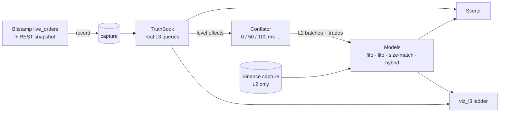

# hft-rs — L2→L3 order-queue inference lab

Most venues publish only **L2**: total size per price level. Queue position, order sizes, and order ages are hidden, but they matter for fill probability, participant classification and microstructure research. Estimators that rebuild **L3** (individual orders) from L2 are common. They are rarely *measured*.

This repo measures them. It records a venue that publishes **every order** (Bitstamp `live_orders`). From that feed it derives the L2 stream an L2-only venue would show, conflation included. Inference models run on the derived L2, and every reconstructed queue is scored against the real one.



## Quick start

```bash
cargo build --release

# 1. Record 15 minutes of BTC/USD ground truth → data/bitstamp/btcusd/<session>/
./target/release/l3lab record --secs 900 --session my-run

# 2. Score all models at several conflation windows (markdown table; --json for raw numbers)
./target/release/l3lab score data/bitstamp/btcusd/my-run --conflate-ms 0,100,1000

# 3. Look at it: truth queue vs inferred queue per level, live accuracy panel
./target/release/viz_l3 --capture data/bitstamp/btcusd/my-run --model hybrid
./target/release/viz_l3 --live bitstamp            # same, streaming
```

`data/` is git-ignored, so record your own captures. `viz_l3` also replays Binance captures from `poc_binance --capture-dir data` (inferred queues only, since that venue has no truth).

## Models

All models keep each level's total equal to the published L2 total; they differ only in *where* a change lands in the queue. Increases always join the back.

| model | decrease handling | uses trades |
|---|---|---|
| `fifo` | consume from the front (all decreases are fills) | no |
| `lifo` | consume from the back (all decreases cancel the newest size) | no |
| `size-match` | cancel the newest order of exactly that size; otherwise consume from the front | no |
| `hybrid` | traded volume fills from the front. The rest of the change is a hidden add (back) or a cancel (exact size match, else newest first) | yes |

New models implement `l3lab::model::QueueModel` (one `apply` call per level change) and register in `model_by_name`.

## Metrics

Sampled after every L2 batch over the top 10 levels per side, after a 30 s warm-up (snapshot levels start as one opaque order each):

- **count MAE / exact**: |true orders − inferred orders| per level.
- **size P / R / F1**: multiset overlap of order sizes (exact lot equality). Precision is over inferred orders, recall over true orders.
- **queue-ahead error**: for each real order that joins a top level, the inferred order created at that level in the same batch is its proxy. Each sample is |qty ahead of the real order − qty ahead of the proxy| / level total. **lost** counts samples where the model already removed the proxy while the real order still rests.

## First results

Bitstamp BTC/USD, 15 min on 2026-10-22 (220,904 L3 messages, no gaps in the event chain):

| conflation | fifo F1 | hybrid F1 | fifo ahead-err mean | hybrid ahead-err mean | hybrid ahead-err p90 | hybrid lost |
|---:|---:|---:|---:|---:|---:|---:|
| 0 ms | 84.3% | 99.1% | 0.014 | 0.002 | 0.000 | 2.4% |
| 50 ms | 73.7% | 77.2% | 0.039 | 0.032 | 0.067 | 11.8% |
| 100 ms | 72.1% | 74.5% | 0.050 | 0.044 | 0.140 | 12.2% |
| 250 ms | 70.1% | 71.4% | 0.073 | 0.069 | 0.269 | 10.8% |
| 1000 ms | 67.8% | 68.7% | 0.110 | 0.109 | 0.500 | 10.0% |

- **Unconflated L2 is almost lossless.** With every event visible, exact size matching recovers the real queues (`size-match` F1 99.9%). That is an upper bound no real feed provides.
- **Conflation, not the heuristic, sets the error.** At Binance-like 100 ms, all four models land within about 3 points of each other. Queue-ahead error has a p90 of 14–19% of level size, and 11–14% of tracked orders lose their proxy.
- **The trade feed helps, but only a little.** With conflation on, `hybrid` has the lowest p90 queue-ahead error at every window (tied at 1 s), but the margin is small next to the cost of conflation.
- **Open question:** unconflated, `hybrid` trails `size-match` (99.1% vs 99.9% F1). Some maker fills don't hit the front of the reconstructed queue. That points either at Bitstamp's matching priority or at how the snapshot's priority is reconstructed, and needs a closer look.

## Repository layout

| crate | role |
|---|---|
| `l3lab` | library + CLI: `TruthBook` (L3 from order events, marketable-order handling), `Conflator` (L3 → L2 batches), models, scorer, `Session` pipeline, Bitstamp recorder/live feed, Bitstamp and Binance capture readers |
| `viz_l3` | egui ladder: truth and inferred queues per level, each order a segment coloured by age; replay with seek, or live |
| `engine_core`, `spsc` | pinned single-thread engine loop with an SPSC-backed logger (the original low-latency PoC) |
| `ws_binance`, `ws_hyperliquid`, `bins` | engine handlers and `poc_binance` / `poc_hyperliquid` binaries. `--capture-dir` writes the Binance captures `viz_l3` replays |
| `xtask` | `cargo run -p xtask -- lint` (fmt check + clippy `-D warnings`) |

### Capture formats

- **Bitstamp** `data/bitstamp/<pair>/<session>/`: `snapshot.json` (raw `order_book?group=2`, ids in time priority), `orders.jsonl` (raw WS frames), `metadata.json` (scale, snapshot time, end reason). The recorder validates the `event_id`/`pre_event_id` chain while recording and stops at the first break, so a capture is always contiguous.
- **Binance** `data/binance/<symbol>/<session>/`: `snapshot.json`, `diffs.jsonl` (`@depth@100ms`), `metadata.json`.

Prices and sizes are parsed into exact integers (`Scale`: 2 price / 8 size decimals by default). Conflation sums and size matching never touch floats.

## Roadmap

1. **Learned cancel placement.** The truth book shows where cancels actually hit the queue. Fit that position distribution per level depth and size, and use it as a model.
2. **Longer and more varied captures** (hours, volatile sessions, other pairs) to check how stable the ranking is.
3. **A second ground-truth venue** (Bitfinex raw books `R0`), to see whether conclusions transfer.
4. **Apply the best model to Binance**, live and from captures, which is where the inferred queues are actually needed.
5. **Resolve the unconflated fill-priority gap** above.

## Credits

The original visual idea, age-coloured queue bars, comes from [OctopusTakopi/binance_l3_est](https://github.com/OctopusTakopi/binance_l3_est) (MIT).
