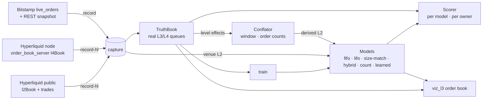

# hft-rs — L2→L3 order-queue inference lab

Most venues publish only **L2**: total size per price level. Queue position, order sizes, and order ages are hidden, but they matter for fill probability, participant classification and microstructure research. Estimators that rebuild **L3** (individual orders) from L2 are common. They are rarely *measured*.

This repo measures them. It records venues that publish **every order**: Bitstamp `live_orders` (L3) and Hyperliquid via a non-validating node (L4, with the owning account of each order). From that feed it either derives the L2 stream an L2-only venue would show, conflation included, or uses the venue's real public L2 feed. Inference models run on that L2, and every reconstructed queue is scored against the real one.



## Quick start

```bash
cargo build --release

# 1. Record 15 minutes of BTC/USD ground truth → data/bitstamp/btcusd/<session>/
./target/release/l3lab record --secs 900 --session my-run

# 2. Score all models at several conflation windows (markdown table; --json for raw numbers)
./target/release/l3lab score data/bitstamp/btcusd/my-run --conflate-ms 0,100,1000

# 3. Train the learned model on one capture, test it on another
./target/release/l3lab train data/bitstamp/btcusd/my-run --conflate-ms 100 --counts --out model.json
./target/release/l3lab score data/bitstamp/btcusd/other-run --conflate-ms 100 --counts --learned model.json

# 4. Look at it: truth queue vs inferred queue per level, live accuracy panel
./target/release/viz_l3 --capture data/bitstamp/btcusd/my-run --model hybrid
./target/release/viz_l3 --live bitstamp            # same, streaming
./target/release/viz_l3 --live hyperliquid --model count   # public L2 only, inferred queues
```

`data/` is git-ignored, so record your own captures. `viz_l3` also replays Binance captures from `poc_binance --capture-dir data` (inferred queues only, since that venue has no truth).

## Hyperliquid

Order-level (L4) data only exists on a node. Running one needs Ubuntu 24.04, 16 vCPU, 128 GB RAM, 500 GB SSD and public ports 4001/4002 (see [hyperliquid-dex/node](https://github.com/hyperliquid-dex/node)). On that box:

```bash
~/hl-visor run-non-validator --write-fills --write-order-statuses --write-raw-book-diffs \
    --batch-by-block --serve-info --disable-output-file-buffering
# in a checkout of hyperliquid-dex/order_book_server
cargo run --release --bin websocket_server -- --address 0.0.0.0 --port 8000
```

Then, from anywhere:

```bash
./target/release/l3lab record-hl --coin BTC --l4-server ws://<node>:8000/ws --secs 900
./target/release/l3lab score data/hyperliquid/BTC/<session> --conflate-ms 100 --counts --by-user 10
./target/release/l3lab score data/hyperliquid/BTC/<session> --venue-l2 --top 5   # real public L2 as input
./target/release/viz_l3 --live hyperliquid --l4-server ws://<node>:8000/ws
```

Without `--l4-server`, `record-hl` captures only the public feed (`l2Book` + `trades`), which works today and can be viewed but not scored.

What the integration does:

- **L4 truth.** The `l4Book` snapshot and per-block diffs (`new` / `update` / `remove`) become truth events with owners. `insertBefore` priority inserts, where a new order jumps ahead of an existing one, are placed exactly. Missed blocks are caught because every diff must reference a live order.
- **Fill attribution is a heuristic.** The `l4Book` stream carries no fills. A size decrease counts as a maker fill unless the block has a non-fill status for that order; a removal counts as a fill only if the block's status for it is `filled`. Exact attribution would need `node_fills_by_block`.
- **Public L2 as model input.** `--venue-l2` drives the models with the real public feed, including the per-level order count `n`. It replaces deriving L2 from truth. The `fast` `l2Book` stream arrives every ~0.5 s and has only **5 levels per side**. Score with `--top 5`. Levels that drift past level 5 vanish from the models, which inflates *lost*.
- **Owners.** `--by-user N` prints size recall and queue-ahead accuracy for the N busiest accounts per model.

**Status:** the L4 path has been checked only on fixtures from the `order_book_server` source and on a Bitstamp capture rewritten into `l4Book` frames (8,992 blocks, synthetic owners). It replays, scores and trains cleanly, but there is no result from real Hyperliquid L4 yet.

## Models

All models keep each level's total equal to the published L2 total; they differ only in *where* a change lands in the queue.

| model | handling | uses trades | uses counts |
|---|---|---|---|
| `fifo` | increases join the back; decreases consume from the front (all fills) | no | no |
| `lifo` | increases join the back; decreases consume from the back (cancel newest) | no | no |
| `size-match` | a decrease cancels the newest order of exactly that size, else consumes from the front | no | no |
| `hybrid` | traded volume fills from the front. The rest is a hidden add (back) or a cancel (exact size match, else newest first) | yes | no |
| `count` | like `hybrid`, but uses the published order count: removes the orders whose sizes explain the drop and splits increases into the right number of orders. Without counts it falls back to `hybrid`. | yes | yes |
| `learned` | per-situation choice among 16 actions (including priority insert at the front), fitted by `l3lab train` | yes | yes |

**How `learned` is trained.** Each level change is described by discretised features: direction, relative size, traded volume, count change, distance from the touch, whether an exact size match exists, and queue length. While replaying a capture, every candidate action is tried, scored against the true queue, and the best one is recorded. The model then keeps per-feature-bucket winners, backing off to coarser buckets when a bucket has too few samples. It is saved as readable JSON.

New models implement `l3lab::model::QueueModel` (one `apply` call per level change) and register in `model_by_name`.

## Metrics

Sampled after every L2 batch over the top 10 levels per side, after a 30 s warm-up. Snapshot levels start as one opaque order each, or as `n` equal orders when counts are published.

- **count MAE / exact**: |true orders − inferred orders| per level.
- **size P / R / F1**: multiset overlap of order sizes (exact lot equality). Precision is over inferred orders, recall over true orders.
- **queue-ahead error**: each real order that joins a top level gets a proxy: the n-th order the model created at that level in the same batch, or the last one it created there if it created fewer. Each sample is |qty ahead of the real order − qty ahead of the proxy| / level total. **lost** counts samples where the model already removed the proxy while the real order still rests.

### Microstructure (viewer)

Computed from the same L2 batches the models see and sampled every 0.5 s of exchange time. Each one is split by bid/ask and by tier: the touch, and the best 20 levels. The ratios are **rolling**: every flow decays exponentially with a 30 s half-life, so a ratio describes the recent past rather than everything since the snapshot. A ratio stays undefined (a gap in the plot) until a side has had at least 3 fills recently, instead of spiking while it divides by almost nothing. The viewer plots them on a log scale over a fixed sliding window (30 s, 2 min or 5 min), with a dashed line at ratio = 1.

- **CTR** (cancellation-to-trade ratio) = cancelled volume ÷ filled volume.
- **OTR** (order-to-trade ratio) = added volume ÷ filled volume.

A level change of `net` where `traded` volume was filled means `net + traded` of adds (if positive) or cancels (if negative). On depth-limited feeds, a level scrolling into or out of the visible window is not counted as flow; Hyperliquid's public book is only 5 levels deep. For reference, Bitstamp BTC/USD shows a CTR of about 50 at the touch and about 670 over the top 20 levels: makers re-quote constantly.

## Results

### Conflation sweep

Bitstamp BTC/USD, 15 min on 2026-10-22 (220,904 L3 messages, no gaps in the event chain):

| conflation | fifo F1 | hybrid F1 | fifo ahead-err mean | hybrid ahead-err mean | hybrid ahead-err p90 | hybrid lost |
|---:|---:|---:|---:|---:|---:|---:|
| 0 ms | 84.3% | 99.1% | 0.016 | 0.002 | 0.000 | 1.8% |
| 50 ms | 73.7% | 77.2% | 0.039 | 0.032 | 0.067 | 11.8% |
| 100 ms | 72.1% | 74.5% | 0.050 | 0.044 | 0.140 | 12.2% |
| 250 ms | 70.1% | 71.4% | 0.073 | 0.069 | 0.269 | 10.8% |
| 1000 ms | 67.8% | 68.7% | 0.110 | 0.109 | 0.500 | 10.0% |

- **Unconflated L2 is almost lossless.** With every event visible, exact size matching recovers the real queues (`size-match` F1 99.9%). That is an upper bound no real feed provides.
- **Conflation, not the heuristic, sets the error.** At Binance-like 100 ms, the rule models land within about 3 points of each other.
- **Open question:** unconflated, `hybrid` trails `size-match` (99.1% vs 99.9% F1). Some maker fills don't hit the front of the reconstructed queue.

### Order counts and training (held-out test)

Trained on the capture above; tested on a second 15-minute capture from the same day (193,588 messages). Derived L2 at 100 ms, with Hyperliquid-style order counts:

| model | count exact | size F1 | ahead err mean | ahead err p90 | lost |
|---|---:|---:|---:|---:|---:|
| fifo | 88.5% | 72.3% | 0.043 | 0.140 | 17.4% |
| size-match | 89.3% | 74.8% | 0.041 | 0.122 | 15.2% |
| hybrid | 89.5% | 74.6% | 0.036 | 0.086 | 16.3% |
| count | 100.0% | 73.1% | 0.020 | 0.051 | 15.8% |
| learned | 99.9% | 72.8% | 0.020 | 0.051 | 15.8% |

- **Publishing order counts is worth more than any heuristic.** Using the count roughly halves queue-ahead error versus `hybrid` (0.036 → 0.020, p90 0.086 → 0.051) and gets the order count exactly right. Exact sizes get slightly worse (F1 −1.5 points), because the count model splits a level into equal-sized orders, which rarely match the real sizes.
- **The learned model doesn't beat the best rule yet.** With counts it converges on `count`. Without counts it ties `size-match`/`hybrid` on F1 but has 14% worse queue-ahead error than `hybrid`. Its labels only look one batch ahead and come from the oracle's own trajectory. Training on the model's own trajectory (DAgger) is the next step.

## Repository layout

| crate | role |
|---|---|
| `l3lab` | library + CLI: `TruthBook` (L3/L4 from order events: owners, priority inserts, marketable orders), `Conflator` (truth → L2 batches, optional counts), models + `learn` (trainer, learned model), scorer (per model and per owner), `Session` pipeline, Bitstamp and Hyperliquid recorders and live feeds, Bitstamp/Hyperliquid/Binance capture readers |
| `viz_l3` | egui order book after [binance_l3_est](https://github.com/OctopusTakopi/binance_l3_est): horizontal per-level queue bars (truth beside inferred, each order a segment coloured by age or k-means size cluster, owners in tooltips), level table, and Microstructure Metrics (CTR/OTR), Sweep / Liquidity-Cost and Depth-Time Heatmap windows, plus the accuracy table. Replay with seek, or live (Bitstamp, Hyperliquid public or L4) |
| `engine_core`, `spsc` | pinned single-thread engine loop with an SPSC-backed logger (the original low-latency PoC) |
| `ws_binance`, `ws_hyperliquid`, `bins` | engine handlers and `poc_binance` / `poc_hyperliquid` binaries. `--capture-dir` writes the Binance captures `viz_l3` replays |
| `xtask` | `cargo run -p xtask -- lint` (fmt check + clippy `-D warnings`) |

### Capture formats

- **Bitstamp** `data/bitstamp/<pair>/<session>/`: `snapshot.json` (raw `order_book?group=2`, ids in time priority), `orders.jsonl` (raw WS frames), `metadata.json` (scale, snapshot time, end reason). The recorder validates the `event_id`/`pre_event_id` chain while recording and stops at the first break, so a capture is always contiguous.
- **Hyperliquid** `data/hyperliquid/<coin>/<session>/`: `public.jsonl` (raw `l2Book` + `trades` frames, arrival order), optional `l4.jsonl` (raw `l4Book` frames), `metadata.json` (scale from `meta`, subscription, end reason). Replay merges both files by time.
- **Binance** `data/binance/<symbol>/<session>/`: `snapshot.json`, `diffs.jsonl` (`@depth@100ms`), `metadata.json`.

Prices and sizes are parsed into exact integers (`Scale`: Bitstamp 2 price / 8 size decimals; Hyperliquid per coin from `meta`). Conflation sums and size matching never touch floats.

## Roadmap

1. **Real Hyperliquid L4**: run the node + `order_book_server`, record, and repeat the tables above with real owners and real public L2 as input.
2. **Train on the model's own trajectory (DAgger)** and look further ahead than one batch, so `learned` can improve on the rules rather than copy them.
3. **Exact Hyperliquid fill attribution** from `node_fills_by_block`, instead of the status heuristic.
4. **Longer and more varied captures** (hours, volatile sessions, other pairs) to check how stable the rankings are.
5. **Apply the best model to Binance**, live and from captures, which is where the inferred queues are actually needed.

## Credits

The original visual idea, age-coloured queue bars, comes from [OctopusTakopi/binance_l3_est](https://github.com/OctopusTakopi/binance_l3_est) (MIT).
